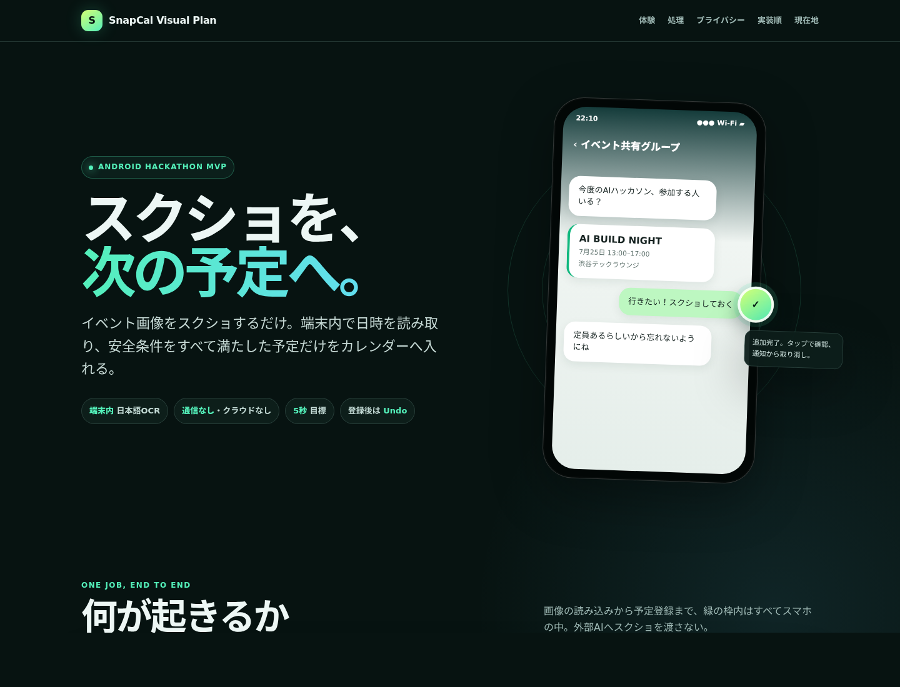

# SnapCal

> **OpenAI Build Week — Apps for Your Life**

SnapCal turns a screenshot into a calendar event without uploading the image. On Android, the user can share one image to SnapCal or explicitly start screenshot monitoring. Bundled Japanese OCR and deterministic Kotlin rules run entirely on the device. SnapCal only auto-adds an event when the title, date, and start time are unambiguous and in the future; otherwise it safely does nothing.

**Try it:** download the signed Android 10+ demo APK from the [v1.0.0 evaluator release](https://github.com/hiroyasu5/snapcal/releases/tag/v1.0.0). The release also includes SHA-256 files and a complete evaluator bundle.

The app writes through Android's standard `CalendarContract`, adds a 30-minute reminder, and provides an Undo action in the result notification. No Google Calendar API key or Codex Calendar plugin is required. A visible, writable Google Calendar that supports reminders can appear as a destination when Android account sync and Google Calendar's **Share Google Calendar data with other apps** setting are enabled.

## Privacy and safety

- Release APKs request neither `INTERNET` nor `ACCESS_NETWORK_STATE`.
- Images, full OCR text, titles, times, locations, and URLs are never persisted by SnapCal.
- The database retains only operational metadata such as SHA-256 content hashes, state, retry count, operation token, and Calendar Event ID; terminal metadata is deleted after 30 days.
- Ambiguous, past, excluded, or incomplete date evidence is rejected instead of guessed.
- Selecting a synced Android calendar may still cause the calendar provider itself to sync the created event.

## Build and test

Requirements: JDK 17 and Android SDK 36.

```bash
export JAVA_HOME=/path/to/jdk-17
export ANDROID_HOME=/path/to/android-sdk
./gradlew clean releaseGate
```

`releaseGate` builds both release variants, runs unit and build checks, rejects forbidden network permissions and dependencies, re-inspects the completed APKs with `aapt`, and copies signed hackathon APKs plus SHA-256 files into `dist/`.

For a quick test, install `dist/app-demo-release.apk` on Android 10 or later. Open SnapCal, grant calendar access, select a writable on-device calendar, then share a single screenshot containing one clear Japanese event such as `SnapCalデモ / 7月21日 19:00`. The result notification includes Undo. Screenshot monitoring additionally needs photo, notification, and overlay permissions and must be explicitly started by the user.

Detailed evaluator instructions are in [`submission/testing-instructions.md`](submission/testing-instructions.md).

### Google Calendar

SnapCal does not call Google Calendar over the network. It lists visible writable calendars exposed by Android Calendar Provider and writes the event to the selected calendar ID. Android's Google sync adapter then handles normal synchronization to Google Calendar. See [`submission/evidence/google-calendar-compatibility.md`](submission/evidence/google-calendar-compatibility.md) for the code path, prerequisites, and verification boundary.

## How Codex and GPT-5.6 built SnapCal

Codex was the primary development environment for the project. GPT-5.6 helped turn the initial one-feature concept into the Android architecture, implement the Kotlin/Compose app, write the deterministic extraction and calendar safety rules, generate tests, run privacy and release gates, and iterate on independent code reviews.

Key decisions developed with GPT-5.6 include:

1. Replace cloud screenshot analysis with a bundled ML Kit Japanese OCR model and remove all runtime network permissions.
2. Use two explicit capture paths—one-image Android sharing and a user-started foreground monitor—feeding the same processing runtime.
3. Fail closed when OCR finds multiple titles, dates, times, separated event regions, non-event keywords, a past time, or an event beyond the bounded future window.
4. Make Calendar writes and Undo recoverable with operation tokens, signatures, reconciliation states, and duplicate protection.
5. Turn privacy claims into an executable `releaseGate` that inspects dependencies, merged manifests, and final APK permissions.

GPT-5.6 was used during implementation and final submission hardening through Codex; it is not called by the Android app at runtime. This preserves the app's offline privacy boundary while showing how Codex can be used to build and verify a production-shaped mobile workflow.

## Project map

- `app/src/main`: Android application source
- `app/src/test`: deterministic domain, state-machine, calendar, and recovery tests
- `dist`: installable signed hackathon APKs and checksums
- `docs/plan-visual.html`: self-contained visual architecture and delivery plan
- `submission`: evaluator instructions, Devpost copy, evidence, screenshots, and demo assets

---

## 日本語

スクリーンショットから日本語の予定を端末内で読み取り、明確な未来イベントだけをAndroidカレンダーへ追加するハッカソン向けアプリです。



## できること

- 常駐監視: ユーザーが明示的に開始したForeground Serviceが新しいスクリーンショットを検出します。
- 共有取込: GalleryやLINEの共有メニューから画像1枚だけをSnapCalへ渡せます。
- 端末内解析: 同梱したML Kit日本語OCRと決定的なKotlinルールだけを使います。
- 安全な登録: 日付・開始時刻・タイトルが一意で、未来かつ400日以内、予定時間24時間以内のイベントだけを自動追加します。
- 30分前通知とUndo: 選択した書込み可能カレンダーへReminder付きで追加し、結果通知から取り消せます。
- 重複・クラッシュ対策: 画像ハッシュ、イベント署名、操作トークンを使い、同じ予定の二重登録を防ぎます。

Google Calendar用のCodexプラグインやAPIキーは不要です。Android標準の`CalendarContract`を使うため、端末に登録済みのローカル／Google等のカレンダーから保存先を選びます。Google Calendarを使う場合は、Googleアカウントのカレンダー同期とGoogle Calendarの「他のアプリとGoogle Calendarのデータを共有」が有効である必要があります。

## プライバシー境界

リリースAPKは`INTERNET`と`ACCESS_NETWORK_STATE`を持ちません。クラウドAI SDK、外部AI API、HTTPクライアントは使わず、同梱したML KitのオンデバイスOCRだけを使用します。画像・OCR全文・予定名・日時・場所・URLはRoom、ファイル、ログ、通知へ保存しません。

永続化するのは、画像内容のSHA-256、予定署名、処理状態、試行回数、操作トークン、Calendar Event IDなどの操作メタデータだけです。終端メタデータは30日後に削除されます。

注意: Googleなど同期型の保存先を選ぶと、追加した予定はAndroidのカレンダー提供元によって同期される場合があります。これはSnapCalからの画像送信ではなく、ユーザーが選んだカレンダーの通常動作です。

## ビルド

必要環境はJDK 17とAndroid SDK 36です。

```bash
export JAVA_HOME=/path/to/jdk-17
export ANDROID_HOME=/path/to/android-sdk
./gradlew clean releaseGate
```

`releaseGate`は次をすべて通過した場合だけ、インストール可能なdemo／production APKとSHA-256を`dist/`へコピーします。

- demo／productionのKotlin単体テスト
- 両release variantの`lintVital`
- 両release variantのビルド
- merged manifestの禁止権限検査
- runtime依存の既知ネットワーク送信ライブラリ検査
- `aapt dump permissions`による完成APKの再検査

ハッカソン配布用のrelease APKはプロジェクトのdebug keyで署名しています。ストア公開時は専用release keyとGoogle Playの権限審査を別途行ってください。

## 使い方

1. `dist/app-demo-release.apk`をAndroid 10（API 29）以上の端末へインストールします。最終E2EはAndroid 16（API 36）AOSPエミュレータで確認済みです。
2. SnapCalを開き、書込み先カレンダーを選びます。
3. 常駐監視を使う場合は、写真全体・通知・オーバーレイ権限を許可して「常駐監視を開始」を押します。
4. 権限を絞る場合は、他アプリの共有メニューからSnapCalを選びます。この経路は写真全体やオーバーレイ権限を必要としません。
5. 予定が追加されたら通知の「取り消す」で、SnapCal自身が作成した予定だけを削除できます。

Android 14以降で写真を一部だけ許可した場合、自動監視は開始せず共有取込へ縮退します。

## 30秒デモ

1. 「SNAPCAL · ON DEVICE」と通信なしの説明を見せる。
2. 保存先を選び、常駐監視を開始して画面端のバブルを見せる。
3. `7月25日 19:00 / ハッカソン発表会`を含む画像をスクリーンショットまたは共有する。
4. バブルが`…`から`✓`へ変わり、予定追加通知が出ることを見せる。
5. カレンダーの30分前Reminderを確認し、通知からUndoする。

詳しいデータフロー、権限、実装順は[視覚化した計画](docs/plan-visual.html)にあります。

## 現在の検証範囲

`releaseGate`は両flavor合計138件のKotlin単体テスト、`lintVital`、releaseビルド、依存・manifest・完成APKの通信禁止検査まで自動実行します。Android 16（API 36）AOSPエミュレータでは、共有取込と常駐監視の両方について、オンデバイスOCR、Calendar追加、複数通知、予定ごとのUndo実削除までE2E確認済みです。実機公開前には、端末メーカーごとのMediaStore・オーバーレイ挙動を追加確認します。
